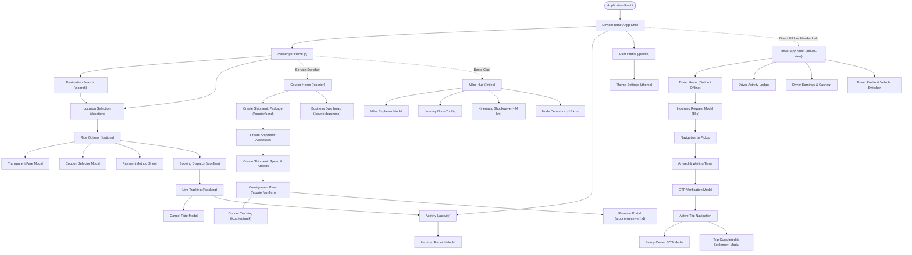
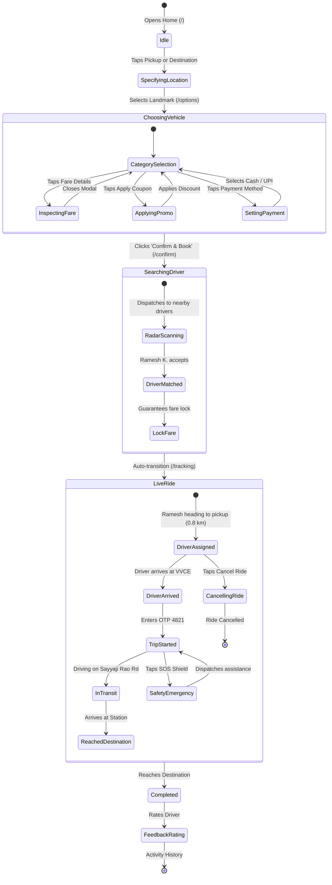
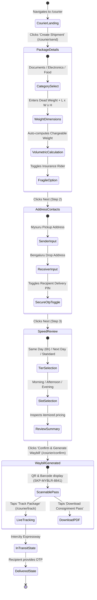
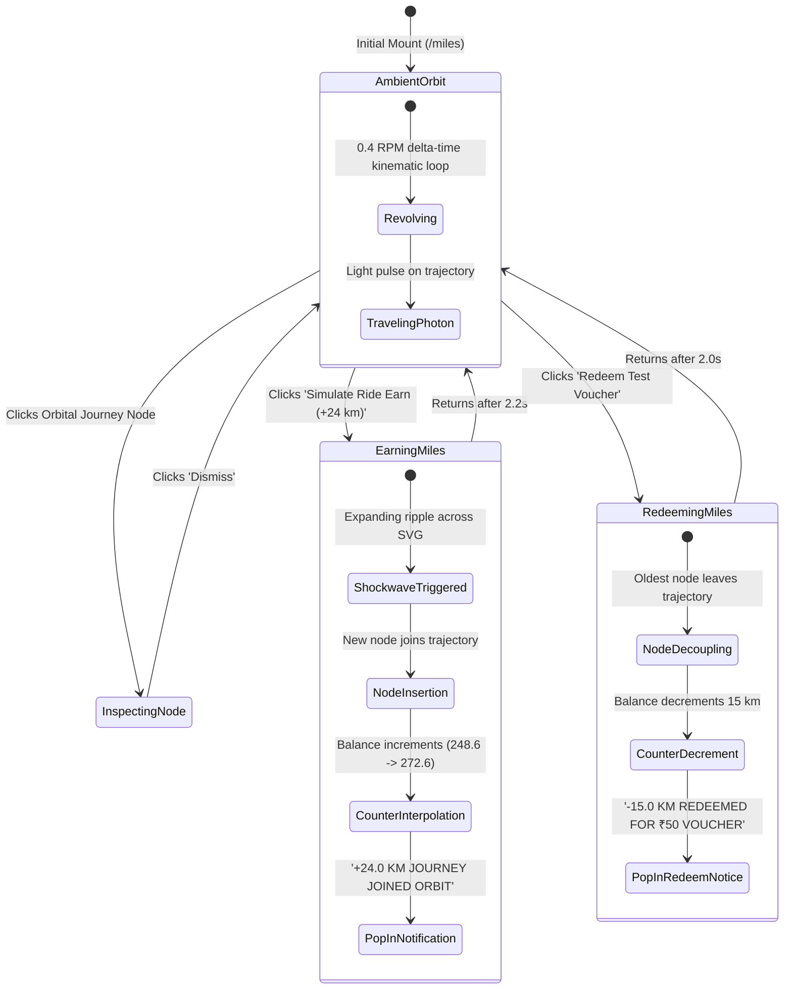
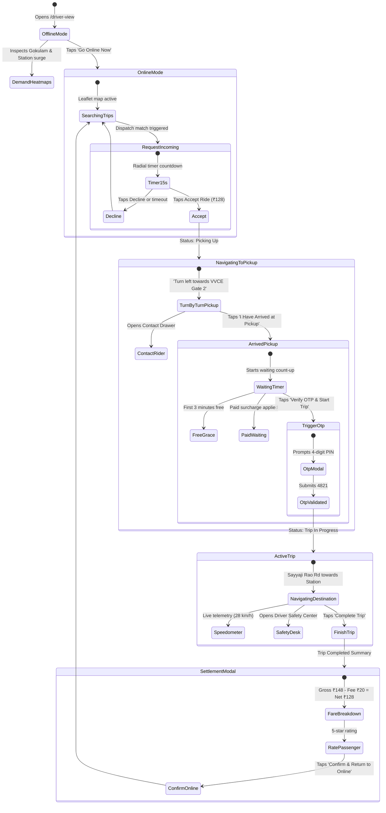

# Skyppy 2.0 | Navigation & Interaction Map

> **Document**: State Machines, User Flows & Interaction Specifications  
> **Audited Version**: Skyppy 2.0.0 (`skyppy-app-ui`)  
> **Diagram Language**: Mermaid Markdown

---

## 1. Master Application Flow & Routing Architecture

---

## 2. Passenger Ride Lifecycle State Machine

---

## 3. Courier Shipment State Machine

---

## 4. The Miles Orbit Kinematic & State Machine

---

## 5. Skyppy Pro Driver Lifecycle State Machine

---

## 6. Interaction Matrix & Micro-Interactions

| Component | Target Screen | Event | Trigger Mechanism | Visual & State Feedback | Consistency Assessment |
|---|---|---|---|---|---|
| **Service Switcher** | `/` & `/courier` | Click | Segment toggle | Animated sliding tab background, instant route navigation | **Consistent** across passenger and courier |
| **Location Input** | `/` | Click | Input row | Navigates to `/location` with pre-filled strings | **Consistent** |
| **Swap Button** | `/` & `/location` | Click | `swap_vert` | Inverts pickup and destination text and coordinates | **Consistent** |
| **Landmark Pin** | `/location` | Click | Leaflet DivIcon | Map smoothly pans to pin, updates store state, shows toast | **Consistent** |
| **Vehicle Category** | `/options` | Click | Vehicle Card | Card acquires blue border, updates selected category and fare | **Consistent** |
| **Fare Breakdown** | `/options` | Click | Link text | Slides up itemized modal with breakdown | **Consistent** |
| **Coupon Code** | `/options` | Click | Promo chip | Applies coupon discount, subtracts amount from total | **Consistent** |
| **Follow Lock** | `/tracking` | Click | Floating control | Toggles between tracking vehicle camera and free pan | **Consistent** |
| **Volumetric Calc** | `/courier/send` | Input | Form fields | Real-time volumetric calculation: $(L \times W \times H) / 5000$ | **Consistent** |
| **The Miles Orbit Node** | `/miles` | Click | SVG `<g>` | Opens animated trip information tooltip | **Consistent** |
| **Simulate Earn** | `/miles` | Click | Action button | Triggers shockwave SVG ripple, adds node, increments balance | **Consistent** |
| **Redeem Voucher** | `/miles` | Click | Action button | Decouples node, decrements balance, shows banner | **Consistent** |
| **Driver Online Toggle** | `/driver-view` | Click | Header button | Transitions between active radar map and demand hotspots | **Consistent** |
| **Driver OTP Autofill** | `/driver-view` | Click | Demo button | Injects "4821" into OTP inputs and enables verification | **Consistent** |
| **Bottom Nav Tabs** | All passenger | Click | Nav item | Spring pill indicator slides to active tab via Framer Motion | **Consistent** |
