# Skyppy 2.0 | Current UI/UX Implementation & Audit Report

> **Audit Type**: Full System State Extraction, Screen Inventory & Behavioral Audit  
> **Target Application**: Skyppy Urban Mobility Platform (`skyppy-app-ui` v2.0.0)  
> **Environment**: Windows 11, Node.js, React 18, Vite 5, Tailwind CSS, Leaflet 1.9, Framer Motion 14, Playwright  
> **Date of Audit**: November 19, 2026  
> **Audit Status**: Complete · Zero Code Modifications (Inspection & Documentation Only)

---

## Executive Overview

This document presents a comprehensive, objective UI/UX audit and architectural state extraction of the Skyppy application in its current state. The application is an urban mobility and intercity logistics platform serving Mysuru and Bengaluru, Karnataka. It encompasses three core operational ecosystems:

1. **Passenger Rides Ecosystem**: On-demand point-to-point urban transit (Electric Auto, Hatchback, Prime Sedan, Prime SUV), intelligent location picking, transparent fare estimates, dispatch matching, and real-time corridor tracking.
2. **Skyppy Move Courier & Logistics Ecosystem**: Intercity door-to-door courier service between Mysuru and Bengaluru with volumetric cargo calculations, 3-step shipment creation wizard, digital consignment waybill passes, real-time interstate tracking, a standalone receiver portal, and a business logistics management dashboard.
3. **Skyppy Pro Driver Experience (`/driver-view`)**: A dedicated, fully interactive driver portal simulating the end-to-end driver lifecycle: availability toggling, radar dispatch requests, turn-by-turn navigation, waiting timers, OTP trip verification, active trip telemetry, fare summaries, daily earnings breakdown, and vehicle category switching.
4. **The Miles Orbit Signature Motion System**: A proprietary motion centerpiece representing distance-backed mobility credits through a multi-node elliptical celestial orbit with dynamic count-up odometers, kinetic earn shockwaves, and voucher redemptions.

All 43 key visual states have been captured via automated Playwright runs and archived in [docs/uiux-audit/screenshots/](file:///c:/Users/Shubha/Desktop/Projects/skyppy-app-ui/docs/uiux-audit/screenshots/).

---

## 1. Visual Screen Inventory & App Shell

### 1.1 Responsive App Shell & Device Frame

The application employs a dual-mode layout architecture governed by [DeviceFrame.tsx](file:///c:/Users/Shubha/Desktop/Projects/skyppy-app-ui/src/components/DeviceFrame.tsx):

- **Mobile Viewports (< 768px)**: Renders directly to `100dvh` (`h-[100dvh] w-full min-h-[100dvh]`) with safe-area insets, fixed header, scrollable main document flow, and fixed bottom navigation.
- **Desktop Viewports (≥ 768px)**: Renders an Apple iPhone 15 Pro device enclosure (`max-w-[420px] h-[844px] rounded-[48px] bg-slate-950 p-2.5 shadow-[0_25px_65px_-15px_rgba(0,14,60,0.4)] border-8 border-slate-800`). The phone frame includes:
  - Top Dynamic Island pill (`w-28 h-6 bg-black rounded-full mx-auto my-1`).
  - Simulated Status Bar with live wall clock (`HH:mm`), cellular signal icon (`signal_cellular_4_bar`), and Wi-Fi icon.
  - Centered presentation within a subtle neutral slate backdrop.

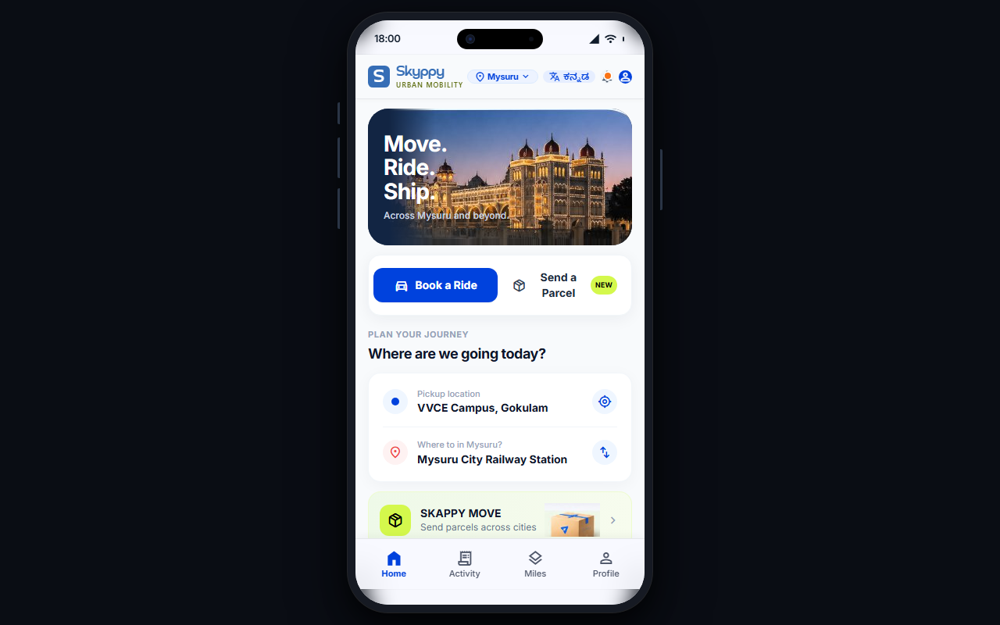

### 1.2 Header Architecture (`Header.tsx`)

The application features three header variants:
1. **`home` variant**:
   - Left: Skyppy official SVG flight chevron emblem + "Skyppy URBAN MOBILITY" brand lockup.
   - Right cluster:
     - City Selector pill: `location_on Mysuru keyboard_arrow_down` (triggers City Modal).
     - Language Switcher button: `translate ಕನ್ನಡ` / `English` (triggers instantaneous i18n store update).
     - Notifications button: Bell icon with orange live indicator badge (triggers Notifications Modal).
     - Profile button: Circular avatar with person icon (navigates to `/profile`).
2. **`tab` variant**: Left-aligned headline title (e.g., "Skyppy Miles", "Activity"), with right-aligned language, notifications, and profile buttons.
3. **`stack` variant**: Back button (`arrow_back` with `navigate(-1)` or `backTo` prop), centered page title, and secondary action button.

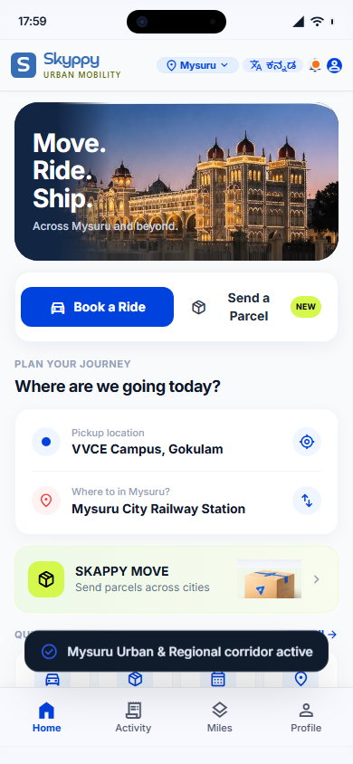
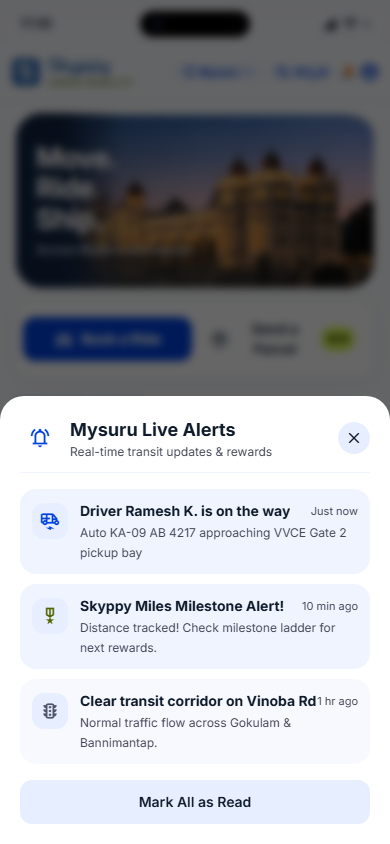

### 1.3 Persistent Bottom Navigation (`BottomNav.tsx`)

- Persistent bottom tab bar fixed at `bottom-0 w-full h-16` with `bg-surface-container-lowest/95 backdrop-blur-xl border-t border-surface-container/50`.
- 4 primary destinations:
  - **Home**: `/` (also active for `/courier`) · Icon: `home`
  - **Activity**: `/activity` · Icon: `receipt_long`
  - **Miles**: `/miles` · Icon: `layers`
  - **Profile**: `/profile` · Icon: `person`
- **Active Tab Motion**: Implemented via Framer Motion's `layoutId="bottomNavActivePill"`. When switching tabs, a subtle rounded background pill (`bg-primary/10 rounded-2xl`) glides horizontally into the target tab, while the icon morphs from outline to filled (`fontVariationSettings: "'FILL' 1"`) and scales to `1.08x`.

---

## 2. Passenger Ride Experience Flow

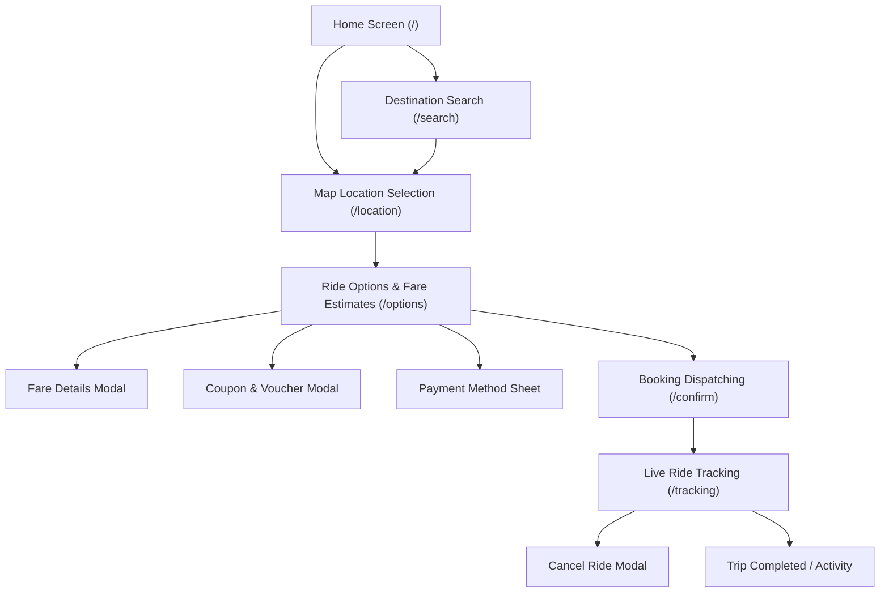

### 2.1 Screen-by-Screen Breakdown

#### Screen 01: Passenger Home (`/`)
- **Banner**: Photographic Mysore Palace golden illumination banner with headline: *"Move. Ride. Ship. Across Mysuru and beyond."*
- **Service Switcher**: Segmented toggle pill with "Book a Ride" (active, royal blue `#0042dd`) and "Send a Parcel (New)" (navigates to `/courier`).
- **Location Selector Card**:
  - Eyebrow: `PLAN YOUR JOURNEY`
  - Heading: `Where are we going today?`
  - Pickup input: Blue concentric circle indicator, title *"VVCE Campus, Gokulam"*, GPS locate button.
  - Destination input: Red pin indicator, title *"Mysuru City Railway Station"*, vertical swap button (`swap_vert`).
- **Quick Actions Grid (4 columns)**:
  - Ride Now (`electric_rickshaw`, Auto • Car)
  - Send Parcel (`package_2`, Intercity)
  - Schedule (`calendar_month`, Ride or Pickup)
  - Track (`location_on`, Ride / Parcel)
- **Skyppy Miles Bento Card**: Dark `#0c1829` enclosure with embedded compact **The Miles Orbit** interactive motion preview (`MilesOrbit variant="compact"`), live balance `232 Miles`, progress bar, and "View Rewards ->" link.
- **Recent Destinations List**: Interactive destination cards for *JSS Medical College & Hospital* (4.2 km, ~12 min) and *Mysuru Railway Station (MYS)* (6.1 km, ~16 min).

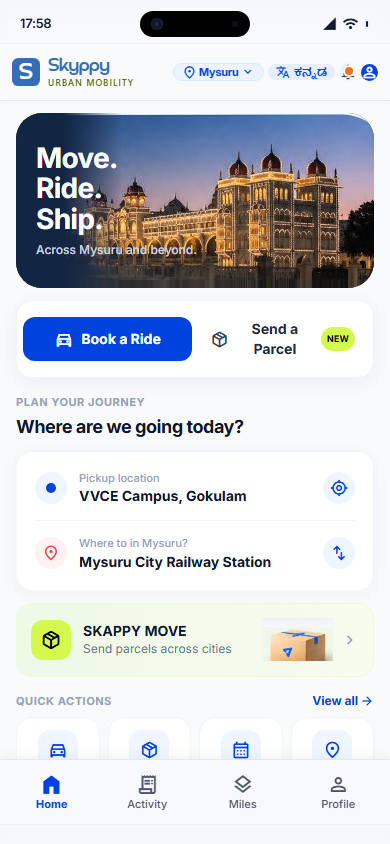

#### Screen 02: Destination Search (`/search`)
- Top search input with back arrow and voice search microphone icon.
- Categorized destination tabs: "All", "Transit Hubs", "Heritage", "Colleges", "Tech Parks".
- Auto-complete listing with distance and driving time indicators.

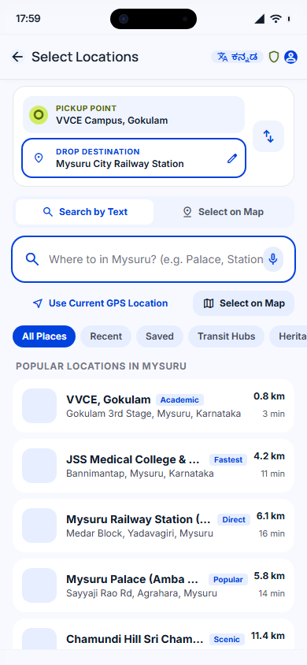

#### Screen 03: Location Selection on Interactive Map (`/location`)
- High-fidelity OpenStreetMap canvas populated with custom interactive pins across Mysuru landmarks (VVCE Gokulam, JSS Bannimantap, Mysore Palace, Railway Station, Chamundi Hill, Infosys Hebbal).
- Panning the map or clicking landmark pins dynamically updates coordinates and recalculates corridor distances.
- Floating controls: "Use Current GPS Location" and "Select on Map".
- Bottom slide-up card with popular destinations list and sticky CTA: *"Confirm Pickup & Destination"*.

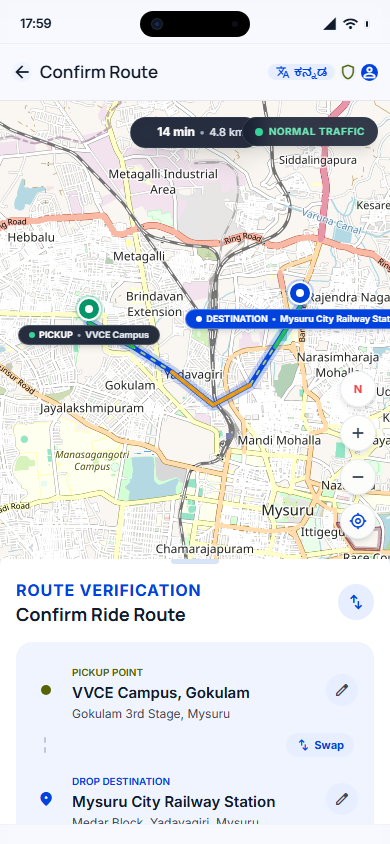

#### Screen 04: Ride Options & Fare Estimates (`/options`)
- Trip summary strip: `VVCE Campus Gate 2 → Mysuru Railway Station • 4.2 km • ~12 min`.
- **4 Official Vehicle Categories**:
  1. **Skyppy Auto**: Mahindra Treo EV / Bajaj Compact (3 seats, ₹78 guaranteed fare, 2 min ETA, fastest in traffic).
  2. **Skyppy Mini / Hatchback**: Tata Tiago EV / WagonR (4 seats, ₹124 fare, 4 min ETA, AC city commute).
  3. **Skyppy Prime Sedan**: Hyundai Aura CNG / Dzire (4 seats, ₹168 fare, 5 min ETA, top-rated drivers).
  4. **Skyppy Prime SUV**: Maruti Ertiga / Toyota Innova (6 seats, ₹245 fare, 8 min ETA, extra luggage capacity).
- **Supporting Modals**:
  - *Transparent Fare Breakdown*: Itemizes base flag-down fare (₹30), distance fare (₹13/km × 4.2 km = ₹54.60), time fare, GST, and net payable.
  - *Coupon & Voucher Modal*: Interactive coupon codes (`MYSURU50`, `GOLDVOYAGER`, `SURGESHIELD`).
  - *Payment Method Sheet*: Cash, Google Pay / PhonePe UPI, Skyppy Wallet.
- Sticky bottom CTA: *"Book [Category] • ₹[Fare]"* navigating to `/confirm`.

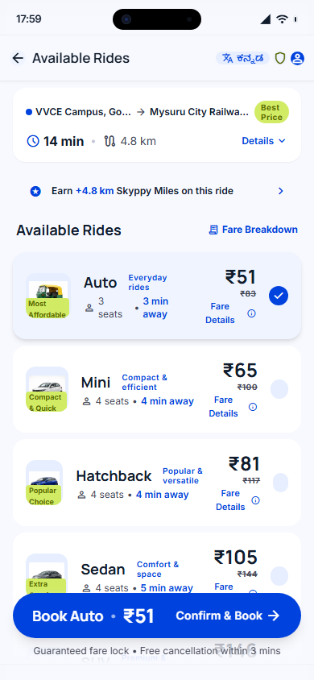
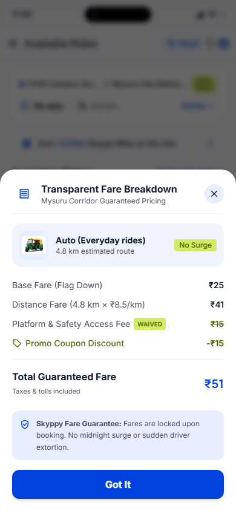

#### Screen 05: Booking Confirmation & Dispatch Matching (`/confirm`)
- Animated radar search simulation matching nearby drivers in Mysuru.
- Live OpenStreetMap viewport displaying corridor route and pulsing matching vehicle icon.
- Real-time matching stepper: `Searching nearby drivers...` → `Driver Found: Ramesh K.` → `Locking Guaranteed Fare`.
- Auto-advances or navigates directly to live tracking.

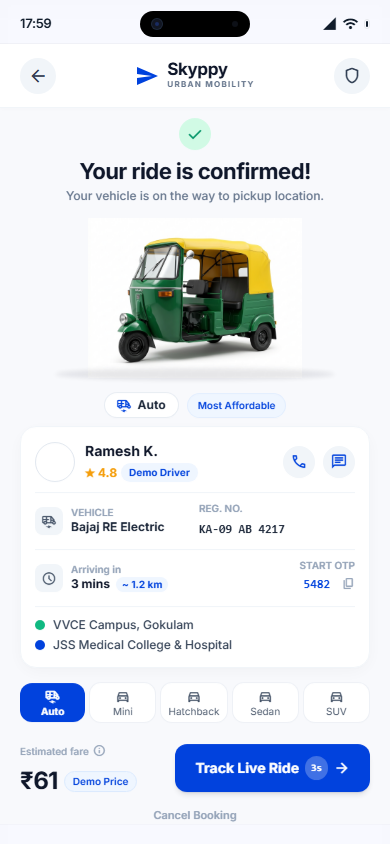

#### Screen 06: Live Ride Tracking (`/tracking`)
- **Top Map Canvas**:
  - OpenStreetMap tiles with custom saturation and contrast filter.
  - Concentric pulse halo on Pickup marker (VVCE Gate 2).
  - Skyppy Royal Blue destination drop-pin (JSS Hospital / Railway Station).
  - High-contrast animated vehicle capsule with forward-projecting directional spotlight headlight beam cone (`SVG linearGradient`).
  - Live driver telemetry tag: `Ramesh • 24 km/h • Kalidasa Rd`.
- **Map Floating Controls**:
  - Live Transit ping pill: `Live Transit • Mysuru Central`.
  - Floating ETA badge: `Arriving in 3 min`.
  - Camera Follow Lock toggle: `Tracking Driver` vs `Free Pan`.
  - Glassmorphic column: North compass, Zoom In, Zoom Out, Recenter map.
- **Bottom Navigation Sheet**:
  - Driver card: Ramesh Kumar (4.9 ★, Mahindra Treo EV `KA-09-EA-4821`).
  - Action buttons: Call Driver, Message, Share Live Trip, Emergency SOS.
  - Trip timeline stepper: `Driver Assigned` → `Driver Arriving` → `Trip in Progress` → `Arrived`.
  - Cancel Ride trigger with cancellation reason selector modal.

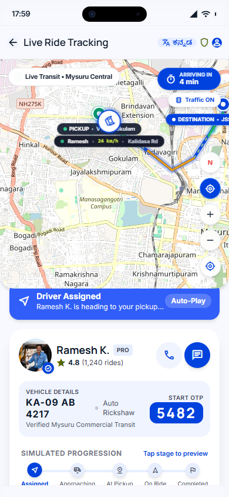

---

## 3. Skyppy Move Courier & Logistics Experience

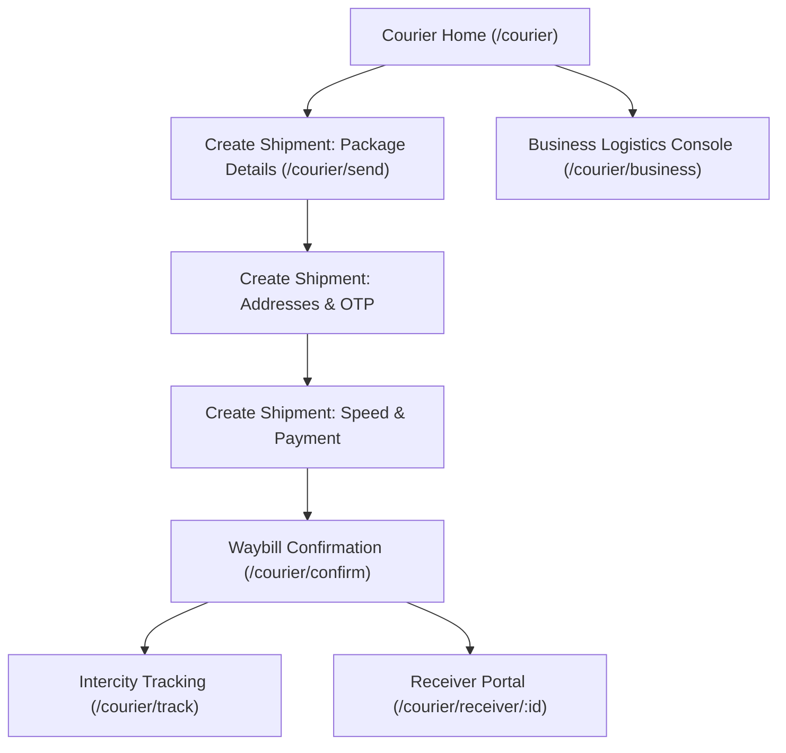

### 3.1 Screen-by-Screen Breakdown

#### Screen 07: Courier Home (`/courier`)
- Service switcher active on "Send a Parcel".
- Hero graphic: 3D Skyppy Move cardboard parcel box with cyan brand seal.
- Value proposition badges: *Intercity Delivery*, *Safe & Secure Handling*, *Live Tracking*, *Proof of Delivery*.
- Active Corridor Card: `FROM: VVCE Campus, Gokulam → TO: Bengaluru, Karnataka`.
- Primary CTA: *"Create Shipment ->"* leading to `/courier/send`.
- Quick action pills: New Shipment, Track Shipment, Scheduled Pickups, Shipment History.

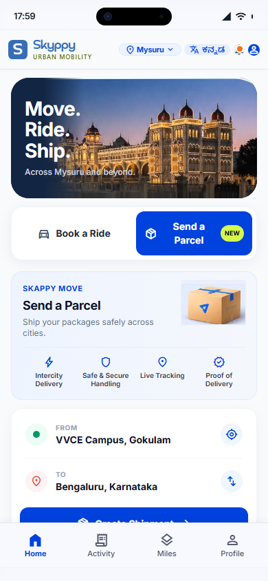

#### Screen 08: Create Shipment 3-Step Wizard (`/courier/send`)
- **Step 1: Package Details**:
  - Package category selector: Documents, Electronics, Food/Perishables, Apparel, Other.
  - Dead weight slider/input (kg).
  - Dimension inputs (Length × Width × Height in cm).
  - **Dynamic Volumetric Calculation**: Automatically calculates volumetric weight using IATA standard formula:
    $$\text{Volumetric Weight (kg)} = \frac{\text{Length (cm)} \times \text{Width (cm)} \times \text{Height (cm)}}{5000}$$
    Highlights chargeable weight as $\max(\text{Dead Weight}, \text{Volumetric Weight})$.
  - Fragile item toggle (+₹40 insurance coverage).
- **Step 2: Addresses & Contacts**:
  - Pickup Address (Mysuru): Contact person, phone, complete street address, floor/unit.
  - Delivery Address (Bengaluru): Recipient name, mobile number, delivery instructions.
  - Secure Delivery OTP verification toggle.
- **Step 3: Speed, Add-ons & Review**:
  - Service tiers: *Same Day Express* (6 hours), *Next Day Priority* (24 hours), *Standard Cargo* (48 hours).
  - Price breakdown: Freight charge, handling fee, GST, total.

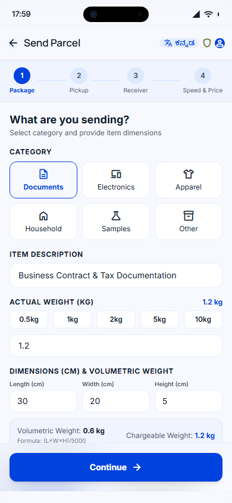
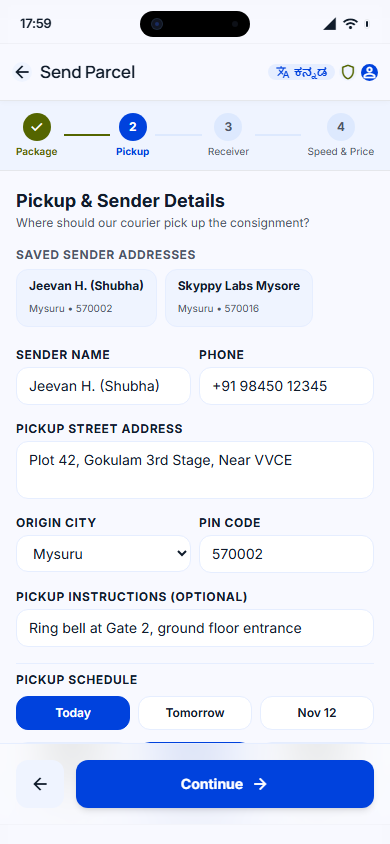
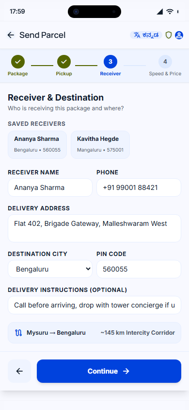

#### Screen 09: Shipment Confirmation & Consignment Pass (`/courier/confirm`)
- Digital Consignment Pass styled like an air waybill boarding pass.
- Waybill Tracking Code: `SKP-MYBLR-8841`.
- Scannable QR code and barcode.
- Item summary: Electronics (2.4 kg), Insured, Signature Required.
- Route corridor: Mysuru Express Hub → Bengaluru Central Sorting.
- Direct links to Track Shipment and Download PDF Invoice.

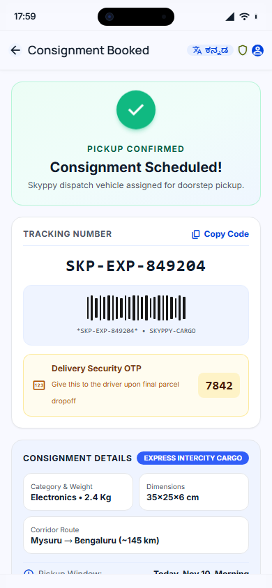

#### Screen 10: Shipment Tracking (`/courier/track`)
- Route map visualizing the 148 km Mysuru-Bengaluru Expressway corridor.
- Stepper milestone timeline:
  1. `Package Picked Up` (Mysuru, 09:15 AM) · Done
  2. `Departed Mysuru Hub` (10:30 AM) · Done
  3. `In Transit on Expressway` (Mandya Toll, 11:45 AM) · Active
  4. `Arrived Bengaluru Sorting Hub` (Estimated 01:15 PM) · Pending
  5. `Out for Delivery` · Pending
- Delivery pin verification code and courier driver contact options.

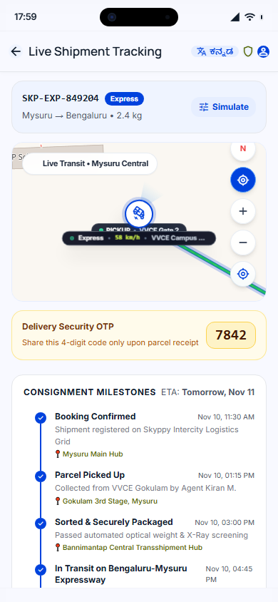

#### Screen 11: Receiver Portal (`/courier/receiver/:id`)
- External-facing lightweight view designed for package recipients without requiring account login.
- Displays package sender, ETA window, live corridor status, and delivery confirmation OTP.

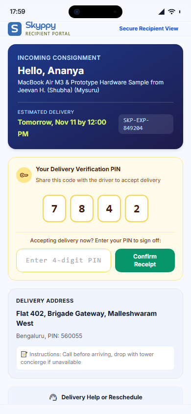

#### Screen 12: Business Logistics Dashboard (`/courier/business`)
- Merchant/Enterprise portal for managing multi-parcel logistics.
- KPI metrics: Total Shipments (142), On-Time Rate (99.2%), Monthly Freight (₹18,450).
- Bulk CSV manifest uploader, active dispatch roster, and developer API credentials drawer.

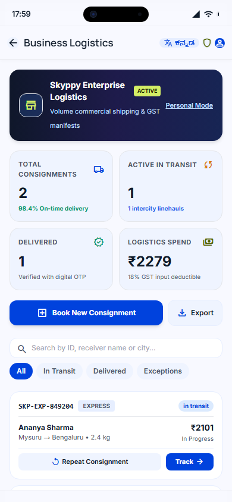

---

## 4. The Miles Orbit Signature Motion Experience

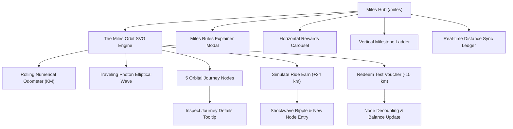

### 4.1 Screen-by-Screen Breakdown

#### Screen 13: Skyppy Miles Hub (`/miles`)
- **Top Header**: Title "Skyppy Miles", Info button (triggers Explainer Sheet), Tier badge (`Tier 2 Explorer`).
- **The Miles Orbit Hero Card**:
  - Deep space dark container `#0a121d` with subtle ambient radial blur spots in Skyppy Royal Blue and Electric Lime.
  - Telemetry bar: `The Miles Orbit` (or Kannada translation) and `100% Distance-Backed` ping badge.
  - **The Miles Orbit Interactive SVG Canvas**:
    - Dual elliptical orbits (secondary guide at 85% scale, primary trajectory at 100% scale).
    - Signature lime-to-blue gradient trajectory (`#d4ee66` → `#0042dd` → `#315ef8`).
    - Traveling photon light pulse revolving continuously along the trajectory.
    - 5 interactive orbital journey nodes representing real-world trips across Mysuru.
    - Center core emblem: Glowing dark disc with rolling numerical odometer (`248.6 KM`), monthly distance subtext (`64.2 km this month`), and tier indicator.
- **Interactive Simulation Controls**:
  - `Simulate Ride Earn (+24 km)`: Spawns a new journey node, triggers a shockwave ripple across the trajectory, animates the counter upward, and pops in a high-contrast feedback notification: `+24.0 KM JOURNEY JOINED ORBIT`.
  - `Redeem Test Voucher`: Decouples the oldest node from the orbit, decrements 15 km, and notifies: `-15.0 KM REDEEMED FOR ₹50 VOUCHER`.
- **Milestone Target Gauge**: Visual progress track indicating current progress towards `300 KM Tier 3 Master` milestone (`83% Achieved`).
- **Rewards Catalog Carousel**: Horizontal snap-scrolling cards with instant "Redeem & Apply" buttons:
  - ₹50 Flat Off (Valid 14 days)
  - Peak Surge Shield (2 passes remaining)
  - ₹15 Commuter Pass (Auto-credited discount)
- **Milestone Ladder**: Vertical step progression showing unlocked and locked tiers (50 km First Explorer, 100 km 15% Off, 250 km Zero Peak Surge, 500 km Priority Dispatch, 1,000 km VIP Club).
- **Distance Ledger**: Real-time sync log listing recently completed trips with distance credits.

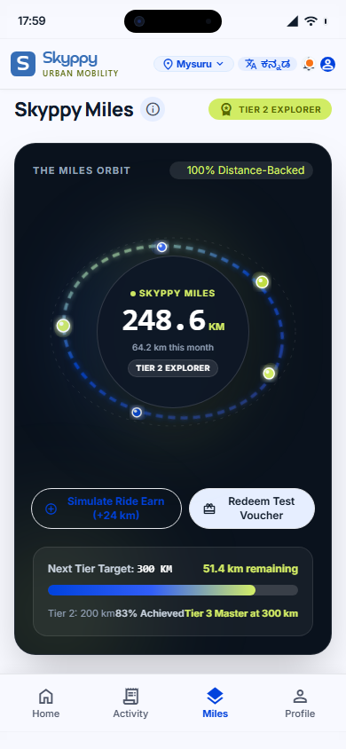
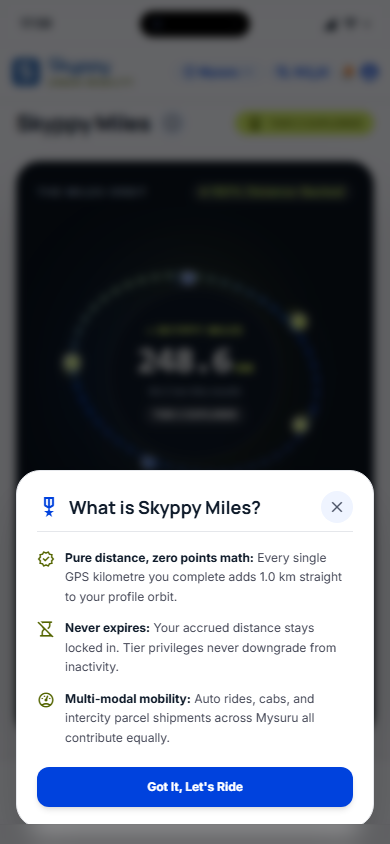
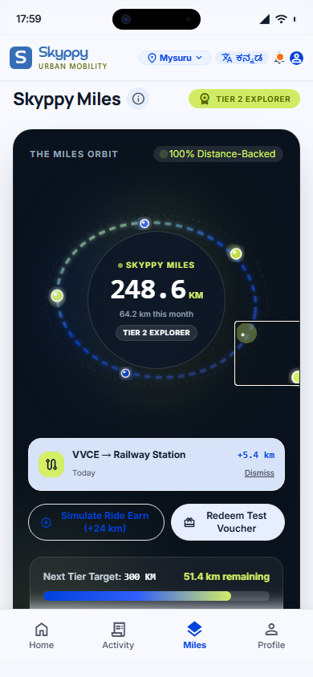
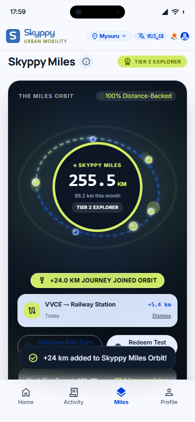
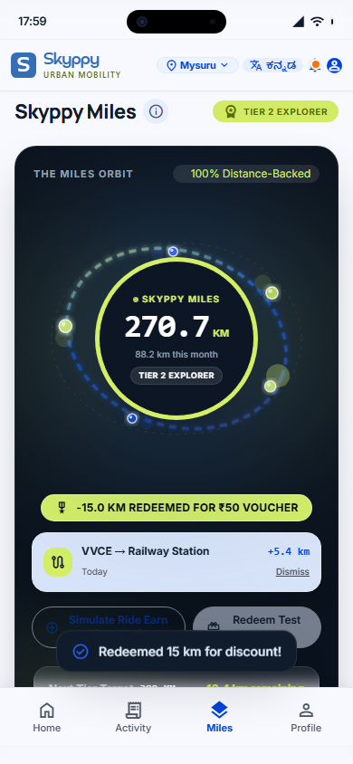

---

## 5. Activity, Profile & Settings

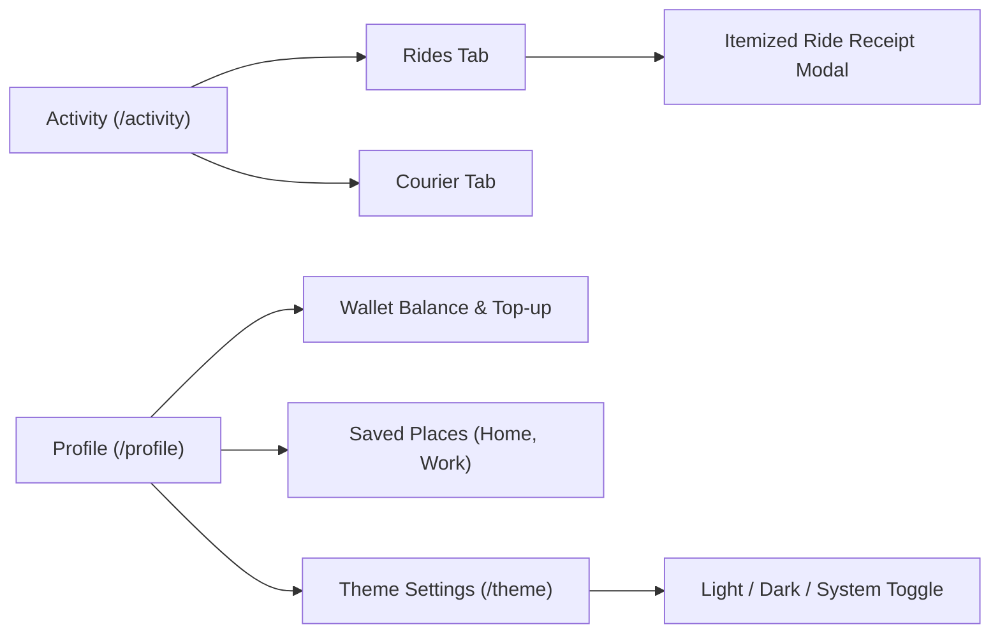

### 5.1 Screen-by-Screen Breakdown

#### Screen 14: Activity History (`/activity`)
- Segmented tab control: "Rides" vs "Courier / Parcels".
- Status filter pills: "All", "Completed", "Cancelled".
- Itemized ride ledger: Date, origin/destination, vehicle category icon, fare paid, payment method, and "View Receipt" trigger.
- **Ride Receipt Modal**: Transparent breakdown showing Base Fare, Distance Fare, Taxes, Driver Rating, and Download Receipt CTA.

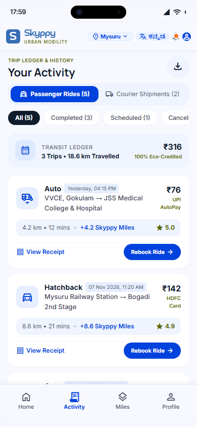
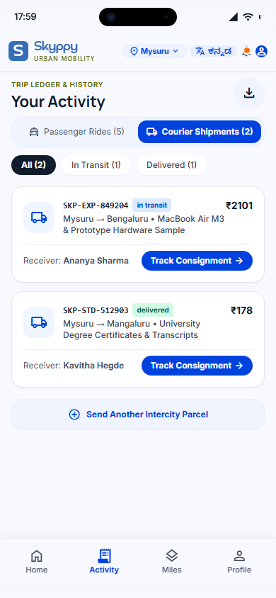
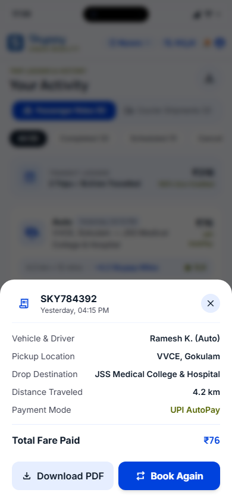

#### Screen 15: Profile & Settings (`/profile`)
- User summary: Name (*Shubha K.*), phone number, rating (4.92 ★), and tier badge.
- Skyppy Wallet card: Balance (₹420), Add Funds button.
- Account options:
  - Saved Places (Home: Gokulam 3rd Stage; Work: Infosys Electronic City).
  - Safety Center & Trusted Emergency Contacts.
  - Payment Methods (Cards, UPI, Wallet).
  - Theme & Appearance (navigates to `/theme`).
  - Language Selection (English / Kannada).
  - Help, Support, and Logout.

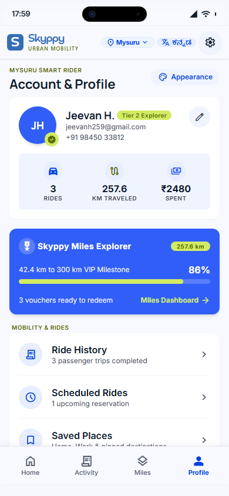

#### Screen 16: Theme Settings (`/theme`)
- Appearance mode switcher: Light, Dark, or System Default.
- Real-time CSS theme variable preview.

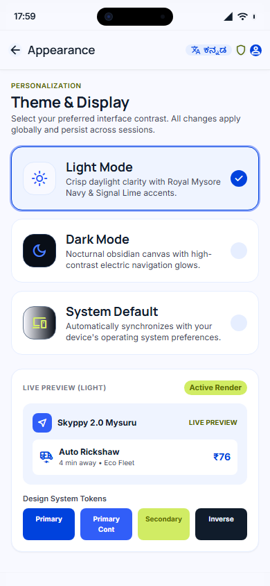

---

## 6. Skyppy Pro Driver Experience (`/driver-view`)

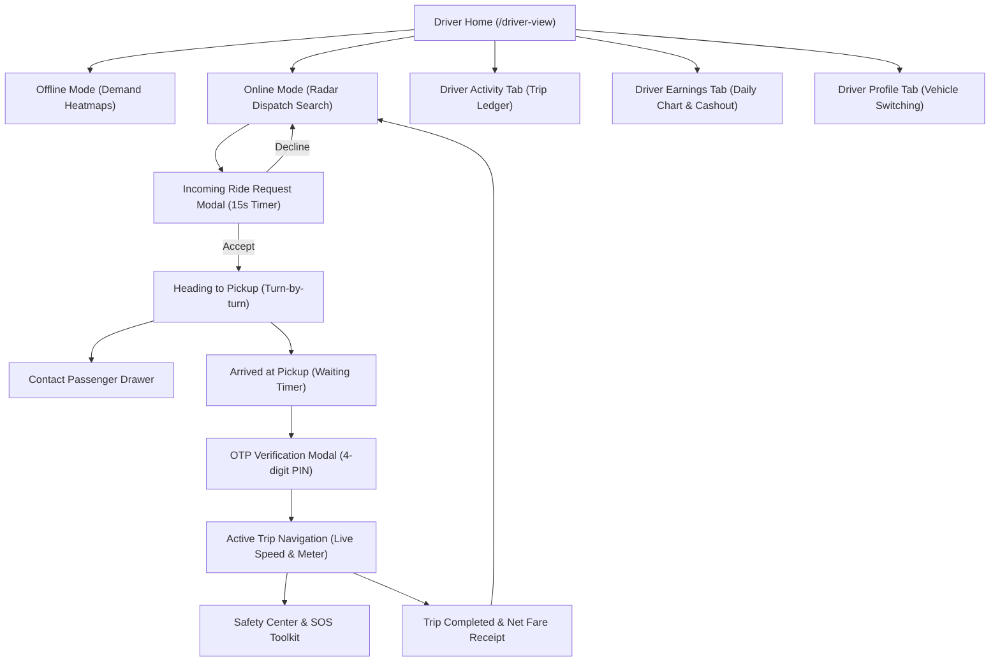

### 6.1 Screen-by-Screen Breakdown

#### Screen 17: Driver Dashboard (`/driver-view`)
- **DriverAppShell**: Custom standalone mobile interface independent of passenger routing.
- **DriverHeader**:
  - Skyppy emblem with "Driver Partner" badge.
  - Interactive Online/Offline switch.
  - Network status indicator ("4G Strong").
  - "Passenger App" escape button to seamlessly return to passenger mode.
  - Demo controls menu button.
- **Offline State**:
  - Status banner: "You are Offline - Go online to start receiving ride requests".
  - "Go Online Now" primary CTA.
  - Mysuru Demand Hotspots: Live surge indicators for *VVCE Campus & Gokulam (1.4x)*, *Mysuru Railway Station (1.8x)*, *Mysore Palace (1.2x)*, and *Infosys Hebbal (1.5x)*.
- **Online State**:
  - Live OpenStreetMap with moving driver auto icon.
  - Status: "Searching trips near Gokulam...".
  - KPI Metrics Ticker: Today's Trips (7), Today's Net Earnings (₹1,485), Online Time (5h 40m), Acceptance Rate (96%).

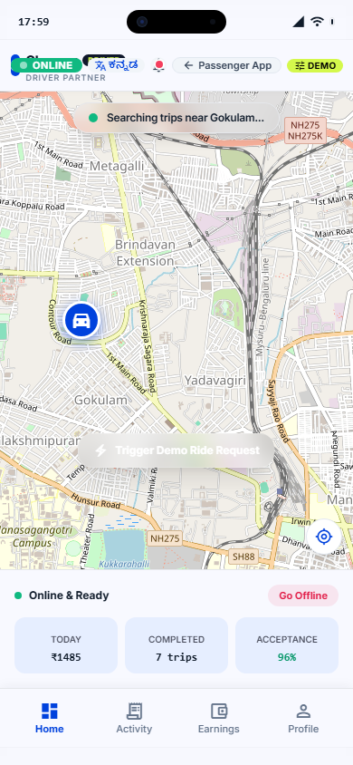
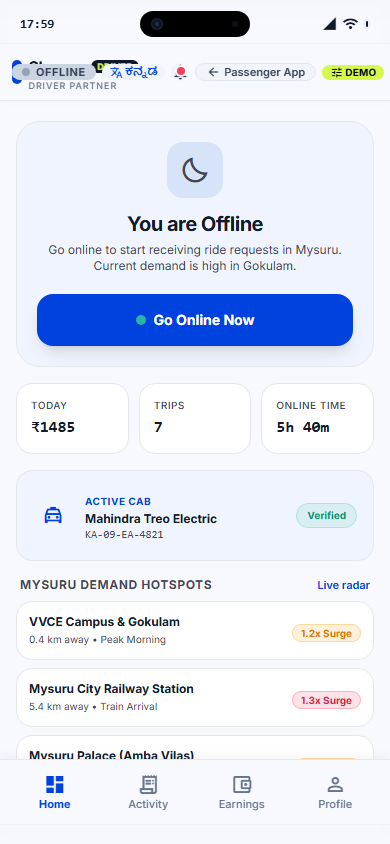

#### Screen 18: Incoming Ride Request Modal
- Overlay card with radial countdown timer (15 seconds).
- Rider details: Sneha R. Gowda (4.9 ★, 42 rides).
- Route details: Pickup at *VVCE Campus Gate 2, Gokulam*; Destination at *Mysuru Railway Station (MYS)*.
- Distance & Duration: 4.2 km • ~12 min.
- Net Driver Earnings: `₹128` (Guaranteed gross fare ₹148 minus ₹20 platform fee).
- Action buttons: "Decline" vs primary "Accept Ride".

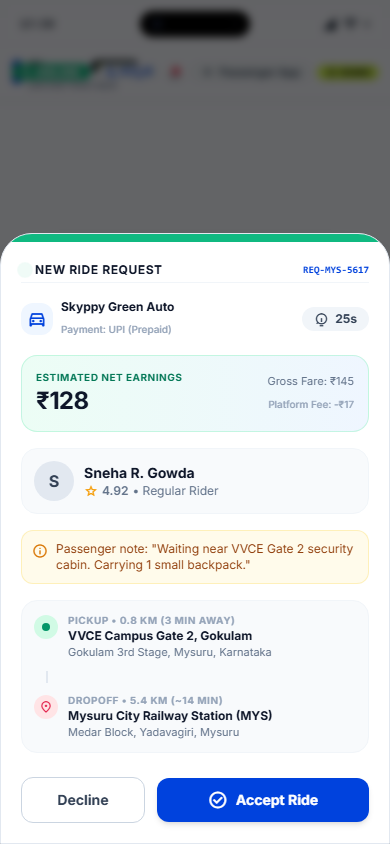

#### Screen 19: Navigation to Pickup & Waiting State
- **Heading to Pickup**:
  - Turn-by-turn direction bar: *"Turn left towards VVCE Gate 2, Gokulam (0.8 km • 3 min)"*.
  - Passenger contact drawer with "Call Sneha" and "Message" triggers.
  - Large button: *"I Have Arrived at Pickup"*.
- **Arrived at Pickup**:
  - Live waiting timer counting upward.
  - Grace period notice: Free waiting for first 3 minutes; automatic paid waiting surcharge (₹2/min) applied thereafter.
  - Primary button: *"Verify OTP & Start Trip"*.

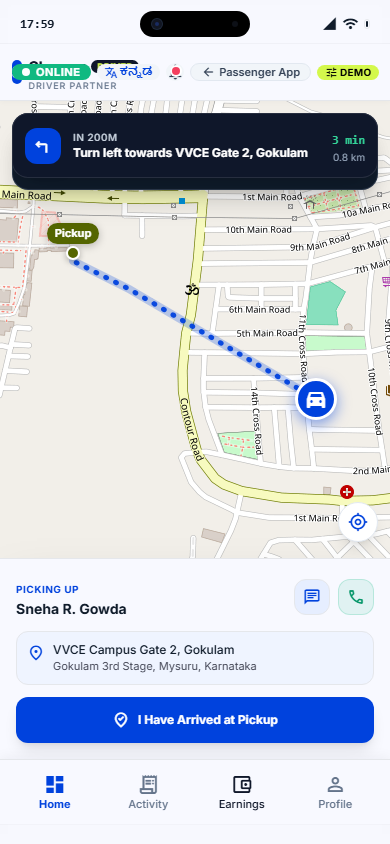
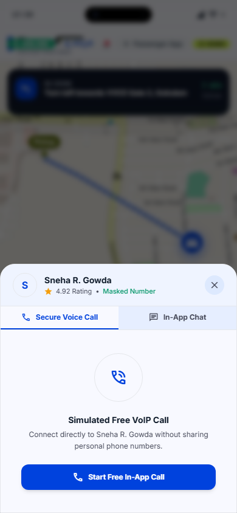
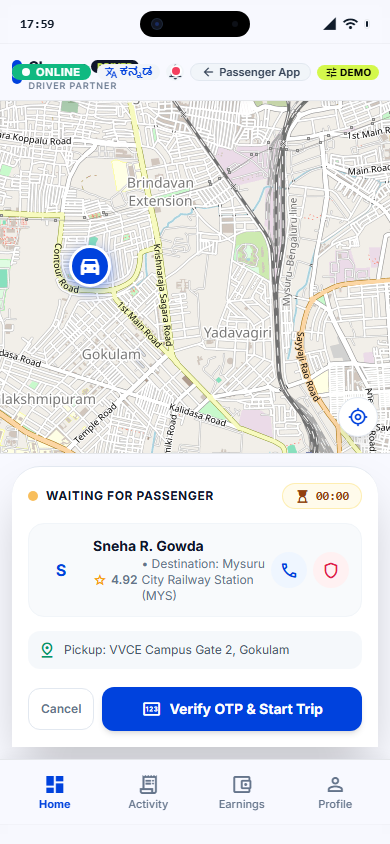

#### Screen 20: OTP Verification Modal
- 4-digit PIN verification modal preventing unauthorized departures.
- Numeric keypad with quick "Auto-fill (4821)" demo helper button.
- Validates against driver store state.

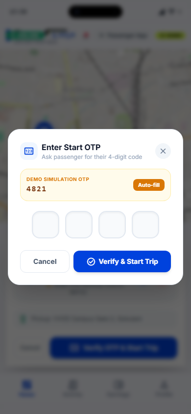

#### Screen 21: Active Trip & In-Trip Safety
- Turn-by-turn destination navigation: *"Head south on Sayyaji Rao Rd towards Railway Station (3.4 km • 9 min)"*.
- Speedometer display: Live speed in km/h (`28 km/h`).
- Live fare meter incrementing with trip progress.
- Floating Safety Shield icon opening the **Driver Safety Center**:
  - 108 Karnataka Police Emergency SOS trigger.
  - Skyppy 24/7 Driver Incident Desk.
  - Vehicle breakdown assistance.
- Primary slider/button: *"Complete Trip"*.

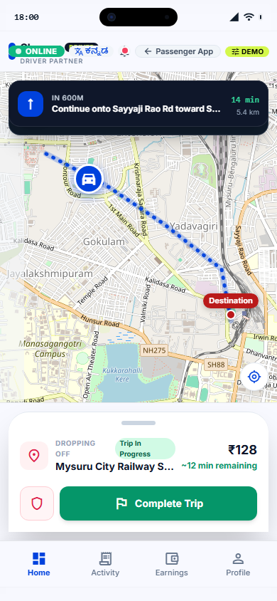
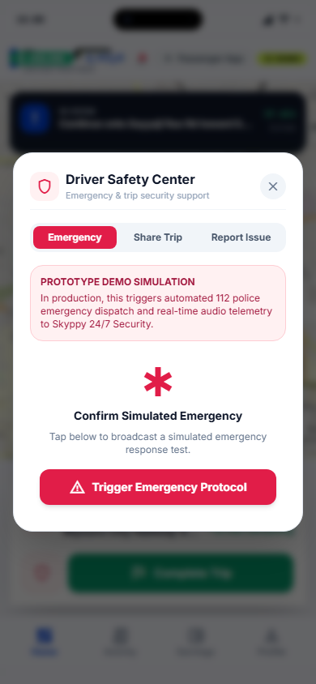

#### Screen 22: Trip Completion & Settlement Modal
- Settlement breakdown:
  - Gross Passenger Fare: `₹148`
  - Skyppy Platform Commission (13.5%): `-₹20`
  - Net Driver Earnings Credited: `₹128`
- Star rating selector for rider feedback.
- Primary CTA: *"Confirm & Return to Online"*.

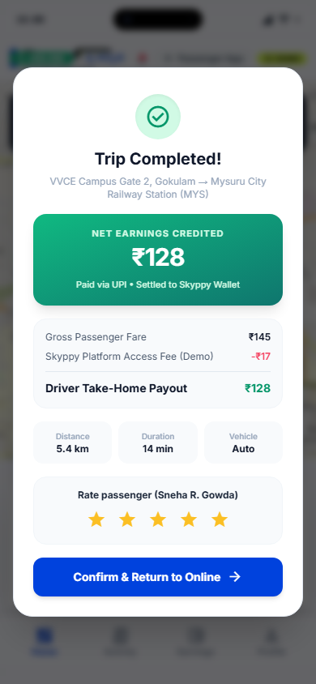

#### Screen 23: Driver Activity, Earnings & Profile Tabs
- **Activity Tab**: Chronological ledger of all completed trips with timestamps, routes, passenger names, and net payouts.
- **Earnings Tab**: Weekly bar chart breakdown (Monday–Sunday), accumulated wallet balance (`₹3,420`), instant bank transfer cashout button, and incentive milestone targets (`₹12,000 / ₹15,000`).
- **Profile Tab**: Profile of Ramesh Kumar, active vehicle switcher (Electric Auto, Mini EV Hatchback, Prime Sedan, Prime SUV), document verification checkmarks, and driver tier badge.

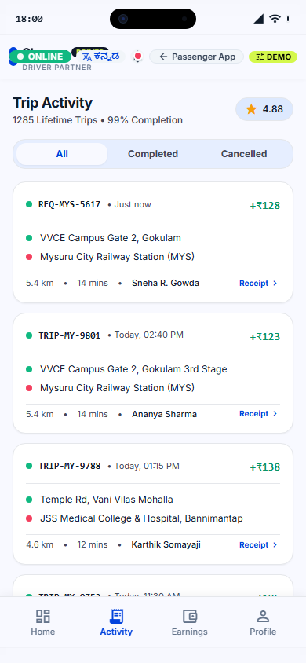
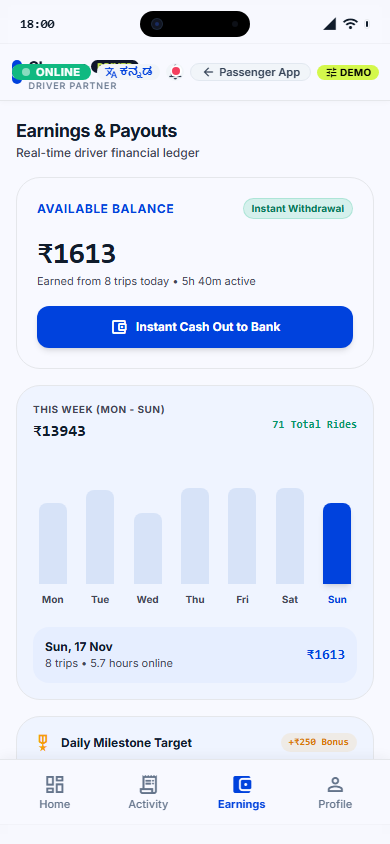
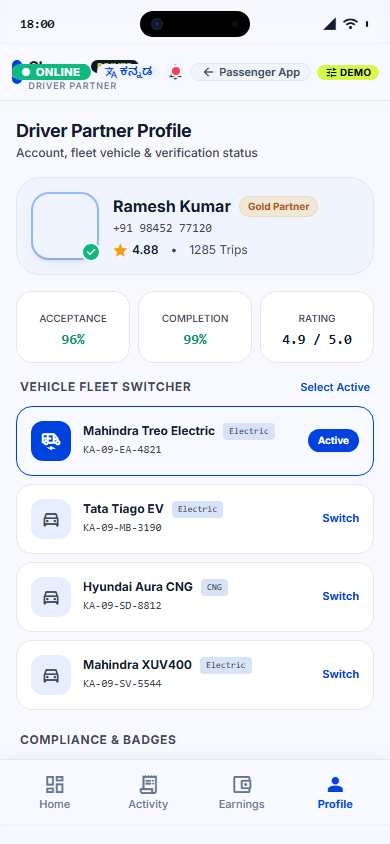
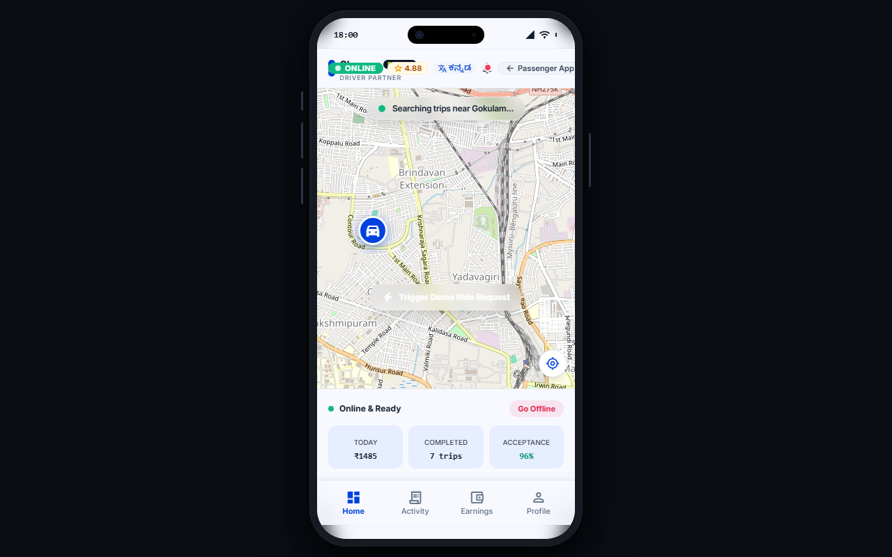

---

## 7. Design System Extraction & Tokens

### 7.1 Color Palette

| Token Name | Hex Code | CSS Variable | Semantic Usage |
| :--- | :--- | :--- | :--- |
| **Primary Brand** | `#0042dd` | `--color-primary` | Main buttons, active tab indicators, polyline core |
| **Primary Container** | `#315ef8` | `--color-primary-container` | Active cards, primary accents, polyline highlight |
| **Secondary / Lime** | `#d4ee66` / `#d4f84c` | `--color-secondary-fixed` | Signature Miles Orbit trajectory, Miles badges, progress bars |
| **Secondary Container** | `#d1ec64` | `--color-secondary-container` | Badge backgrounds, accent containers |
| **Surface Dark (Space)** | `#0a121d` | N/A | Miles Orbit hero background, bento enclosures |
| **Surface Dark (Navy)** | `#0c1829` | N/A | Home screen Miles card |
| **Surface Dark (Charcoal)**| `#101c2b` | `--color-on-background` | Dark headers, high-contrast badges |
| **Surface Light** | `#f8f9ff` | `--color-surface` | Default page background |
| **Surface Container Low** | `#eff4ff` | `--color-surface-container-low` | Light card backgrounds, secondary containers |
| **Surface Container Lowest**| `#ffffff` | `--color-surface-container-lowest`| Crisp white cards, modal bodies |
| **Text Primary** | `#101c2b` | `--color-on-surface` | Primary typography |
| **Text Secondary** | `#434655` | `--color-on-surface-variant`| Supporting body copy |
| **Text Tertiary / Muted**| `#747687` | `--color-outline` | Subtext, timestamps, inactive icons |
| **Success / Online** | `#10b981` / `#22c55e` | N/A | Online status pill, pickup halo, free flow traffic |
| **Error / Cancel** | `#ba1a1a` / `#ef4444` | N/A | SOS buttons, cancel triggers, error states |
| **Warning / Moderate** | `#f59e0b` | N/A | Moderate traffic lines, waiting warnings |

### 7.2 Typography System

- **Primary Heading & Numeric Font**: `Manrope`, sans-serif
- **Body & Label Font**: `Inter`, sans-serif
- **Icon Font**: `Material Symbols Outlined` (Google Fonts)

| Typographic Token | Font Family | Size (px) | Line Height (px) | Weight | Letter Spacing |
| :--- | :--- | :--- | :--- | :--- | :--- |
| `headline-xl` | Manrope | 32px | 40px | 700 Bold | -0.02em |
| `headline-xl-mobile` | Manrope | 26px | 34px | 700 Bold | -0.02em |
| `headline-lg` | Manrope | 22px | 28px | 700 Bold | -0.01em |
| `headline-md` | Manrope | 18px | 24px | 600 SemiBold | Normal |
| `numeric-xl` | Manrope | 24px | 28px | 700 Bold | Normal |
| `numeric-md` | Inter | 16px | 20px | 700 Bold | Normal |
| `body-lg` | Inter | 16px | 22px | 500 Medium | Normal |
| `body-md` | Inter | 14px | 20px | 400 Regular | Normal |
| `body-sm` | Inter | 12px | 16px | 400 Regular | Normal |
| `label-lg` | Inter | 14px | 18px | 600 SemiBold | 0.01em |
| `label-md` | Inter | 12px | 16px | 600 SemiBold | Normal |
| `label-sm` | Inter | 10px | 12px | 700 Bold | 0.04em |

### 7.3 Border Radii & Elevation

- **Buttons & Small Badges**: `rounded-full` (9999px) or `rounded-xl` (12px)
- **Standard Cards**: `rounded-2xl` (16px)
- **Hero Containers & Major Bento Cards**: `rounded-3xl` (24px)
- **Desktop Phone Mockup Enclosure**: `rounded-[48px]`
- **Elevation Tokens**:
  - `shadow-xs`: Subtle card borders
  - `shadow-sm`: Standard resting card elevation
  - `shadow-md`: Floating map controls, active cards
  - `shadow-xl`: Modal sheets, vehicle pins
  - `device-shadow`: `box-shadow: 0 25px 65px -15px rgba(0, 14, 60, 0.4)`

---

## 8. Interaction & Motion Audit

### 8.1 Motion Architecture
- **Kinematic Orbit Rendering**: Implemented using `requestAnimationFrame` delta-time tracking inside `MilesOrbit.tsx`. Revolves journey nodes at an ambient 0.4 RPM along an elliptical path ($x = c_x + r_x \cos\theta$, $y = c_y + r_y \sin\theta$). Fully disables rotational calculations when `useReducedMotion()` returns true.
- **Odometer Counter**: Smooth cubic-out easing interpolation for numerical kilometer values ($1 - (1 - p)^3$).
- **Tab Bar Morphing**: Uses Framer Motion's shared layout animation (`layoutId="bottomNavActivePill"` with `{ type: 'spring', stiffness: 380, damping: 30 }`) to provide native-app tab continuity.
- **Micro-Interactions**: All clickable buttons and interactive cards utilize `active:scale-95` or `active:scale-[0.98]` tactile press states.

### 8.2 Map Interaction
- OpenStreetMap canvas powered by Leaflet 1.9 with desaturated high-resolution OSM tiles.
- Touch panning, double-tap zoom, pinch-to-zoom, and floating zoom in/out controls.
- Dynamic `fitBounds` with intelligent bottom-sheet offset calculation (`resolvedBottomPadding = 240px` in live tracking) ensuring corridor waypoints and vehicle pins remain visible above floating bottom sheets.

---

## 9. Comprehensive Visual Inconsistencies & UX Observations

> [!NOTE]
> Per the strict audit protocol, these items are documented objectively for product leadership and design reviewers. No code changes have been introduced.

1. **Brand Naming Inconsistency**:
   - In `RidesHome.tsx` and `CourierHome.tsx`, code comments and certain banners render the brand title as `"SKAPPY MOVE"` and `"SKAPPY MILES"`, whereas the official emblem and platform name is consistently `"Skyppy"`.
2. **Dual Design Token Paradigm**:
   - While `tailwind.config.js` defines an extensive Material 3 token palette (`surface-container-highest`, `on-surface-variant`, `primary-container`), multiple components bypass these tokens and hardcode standard Tailwind Slate classes (`bg-slate-900`, `text-slate-400`, `border-slate-800/80`).
3. **Corner Radius Multiplicity**:
   - Different cards alternate between `rounded-xl` (12px), `rounded-2xl` (16px), and `rounded-3xl` (24px) within the same scroll view without strict hierarchical justification.
4. **Header Horizontal Density on Narrow Viewports**:
   - On viewports with widths ≤ 360px, the 5 items in `Header.tsx` (Logo lockup, City selector pill, Language button, Notifications bell, Profile avatar) cause horizontal tightness.
5. **Desktop Frame Discrepancy**:
   - Passenger pages (`/`, `/courier`, `/miles`, etc.) are wrapped within the phone enclosure defined in `DeviceFrame.tsx`. However, the driver view (`/driver-view`) uses `DriverAppShell` without the phone enclosure on desktop, spanning 100% of the browser width unless manually resized.
6. **Miles vs Kilometer Nomenclature**:
   - The loyalty system is branded "Skyppy Miles", yet all calculations, counters, and milestone thresholds are displayed in metric Kilometers (e.g. `248.6 KM`, `68 miles to Gold`, `50 km First Explorer`). A clear 1:1 equivalency footnote is recommended.

---

## 10. Audit Verification & Artifact Map

| File Path | Description |
| :--- | :--- |
| [UIUX_CURRENT_STATE.md](file:///c:/Users/Shubha/Desktop/Projects/skyppy-app-ui/docs/uiux-audit/UIUX_CURRENT_STATE.md) | Comprehensive system-wide UI/UX state extraction report |
| [SCREEN_INVENTORY.md](file:///c:/Users/Shubha/Desktop/Projects/skyppy-app-ui/docs/uiux-audit/SCREEN_INVENTORY.md) | Route-by-route screen inventory with layouts, components, and states |
| [DESIGN_SYSTEM.md](file:///c:/Users/Shubha/Desktop/Projects/skyppy-app-ui/docs/uiux-audit/DESIGN_SYSTEM.md) | Extracted design tokens, color palette, typography, radii, and shadows |
| [INTERACTION_MAP.md](file:///c:/Users/Shubha/Desktop/Projects/skyppy-app-ui/docs/uiux-audit/INTERACTION_MAP.md) | Complete navigation and state transition diagrams (Mermaid) |
| [UIUX_ISSUES.md](file:///c:/Users/Shubha/Desktop/Projects/skyppy-app-ui/docs/uiux-audit/UIUX_ISSUES.md) | Categorized list of visual, structural, and behavioral inconsistencies |
| [AUDIT_SUMMARY.md](file:///c:/Users/Shubha/Desktop/Projects/skyppy-app-ui/docs/uiux-audit/AUDIT_SUMMARY.md) | Executive summary of audit findings, test suites, and screenshot catalog |
